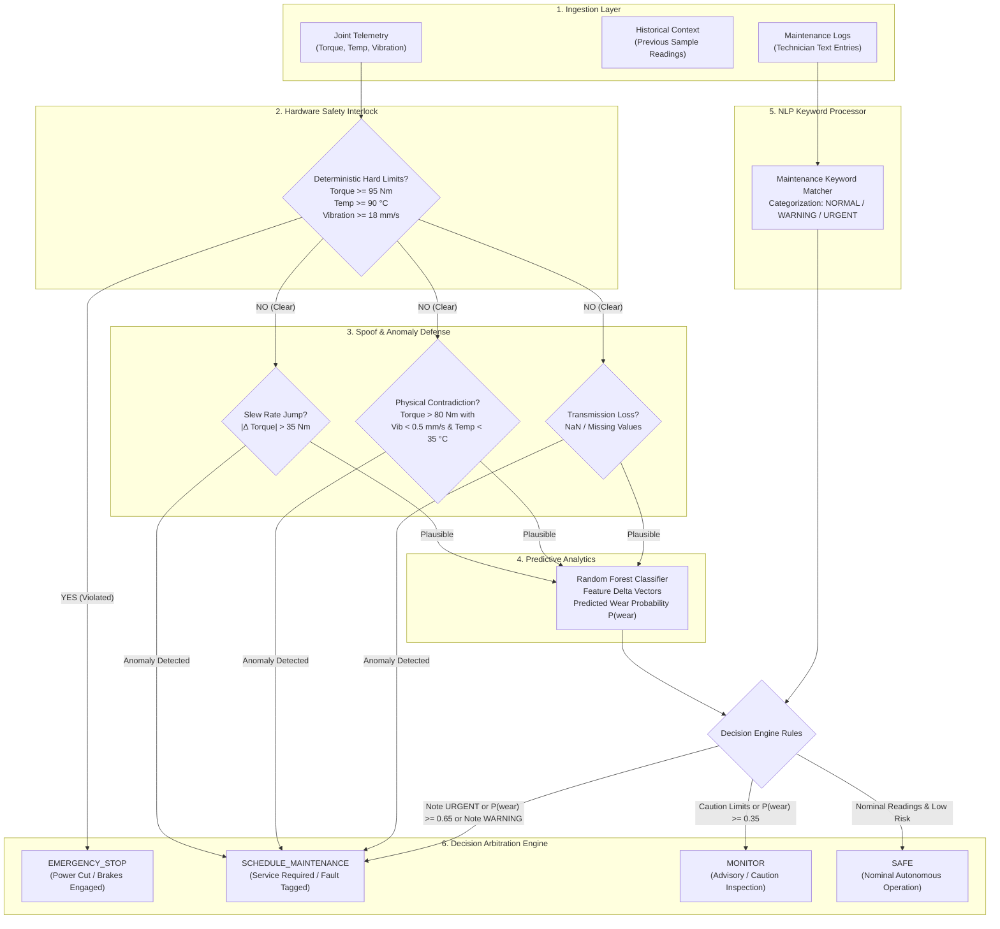

# Robotic Arm Joint Health Monitoring System

**Course:** System Automation (One-Credit Core Assignment)  
**Target Mechanism:** Simulated 6-Axis Industrial Robotic Manipulator (Articulated Arm)  
**Monitored Joints:** Shoulder (Joint 1), Elbow (Joint 2), Wrist (Joint 3)  
**Monitored Telemetry:** Dynamic Torque (Nm), Core Temperature (°C), Tri-axial Vibration RMS (mm/s)  

---

## 1. Safety & Educational Disclaimer

> [!CAUTION]
> **Educational Simulation Notice:** This software is an academic engineering simulation designed solely for educational and research demonstration. It is **not** a certified industrial safety controller.
>
> Operational industrial robots require deterministic safety interlocks certified under **ISO 10218** (Robots and robotic devices — Safety requirements for industrial robots), **ISO 13849-1** (Safety of machinery — Safety-related parts of control systems, PL d/e), and **IEC 61508 / IEC 62061** (Functional safety of safety-related electrical/electronic/programmable electronic control systems, SIL 2/3).
>
> All threshold values, physical relationships, and classification models in this repository are illustrative approximations. Deployment on physical machinery requires manufacturer specifications, formal risk assessments, and hardware-level safety relays.

---

## 2. Project Overview and Objectives

Modern high-throughput manufacturing cells demand autonomous condition monitoring to prevent catastrophic joint failures, product contamination, and unscheduled downtime. This project delivers an automated, end-to-end joint health monitoring system for an articulated 6-axis industrial robotic arm.

### Core Objectives
1. **Deterministic Safety Gating:** Implement immediate, hard-coded safety interlocks that cut motor power independently of any machine learning model when physical thresholds are breached.
2. **Predictive Wear Classification:** Programmatically generate synthetic historical telemetry (≥300 labeled records) to train a Random Forest classifier that detects sub-critical mechanical wear.
3. **Technician Note NLP Processing:** Parse maintenance log records using keyword extraction to correlate qualitative human observations with numerical telemetry.
4. **Sensor Spoofing & Anomaly Defense:** Detect adversarial sensor manipulation, wire fractures, and stuck sensor values using kinematic slew-rate checks and cross-sensor thermodynamic plausibility rules.
5. **Unified Final Decision Engine:** Synthesize all data streams into exactly one deterministic operational decision per arm: `SAFE`, `MONITOR`, `SCHEDULE_MAINTENANCE`, or `EMERGENCY_STOP`.
6. **Industrial Operator Dashboard:** Provide a responsive Streamlit dashboard featuring dark navy styling, real-time KPI cards, interactive manual overrides, telemetry progress bars, and diagnostics.

---

## 3. System Architecture & Data Flow



---

## 4. Technology Stack & Compatibility

| Component | Technology | Version | Purpose |
| :--- | :--- | :--- | :--- |
| **Language** | Python | 3.13.9 / 3.10+ | Core runtime and pipeline execution |
| **Dashboard** | Streamlit | 1.51.0 | Real-time industrial telemetry visualization |
| **Data Processing** | pandas | 3.0.5 | Tabular telemetry manipulation and feature engineering |
| **Numerics & Random** | NumPy | 2.3.5 | Array computations, clip operations, PRNG generation |
| **Machine Learning** | scikit-learn | 1.7.2 | Random Forest ensemble classifier and evaluation metrics |
| **Model Persistence** | joblib | 1.5.2 | Serialization of trained ML pipeline |
| **Unit Testing** | Python `unittest` | Built-in | Automated test suite validating all 7 criteria |

---

## 5. Installation and Execution Instructions

### Environment Verification

This repository is validated with Anaconda Python at:
```text
C:\ProgramData\anaconda3\python.exe (Python 3.13.9)
```

### Option A: Direct Execution using Anaconda Python (Recommended)

1. Open a terminal (PowerShell or Command Prompt) and navigate to the project directory:
   ```powershell
   cd robotic_arm_joint_health
   ```

2. Verify dependencies:
   ```powershell
   & "C:\ProgramData\anaconda3\python.exe" -m pip install -r requirements.txt
   ```

3. Run the automated unit test suite:
   ```powershell
   & "C:\ProgramData\anaconda3\python.exe" -m unittest discover -s tests -v
   ```

4. Launch the Streamlit operator dashboard:
   ```powershell
   & "C:\ProgramData\anaconda3\python.exe" -m streamlit run app.py
   ```

5. Open your web browser at:
   ```text
   http://localhost:8501
   ```

### Option B: Local Dedicated Virtual Environment

If you prefer an isolated virtual environment:
```powershell
cd robotic_arm_joint_health
& "C:\ProgramData\anaconda3\python.exe" -m venv .venv
.\.venv\Scripts\Activate.ps1
pip install -r requirements.txt
python -m unittest discover -s tests -v
python -m streamlit run app.py
```

---

## 6. Dataset Generation and Model Training

### Programmatic Generation (`data/historical_joint_readings.csv`)

The historical dataset is generated programmatically using deterministic seed initialization (`numpy.random.default_rng(seed=42)`). No external internet connectivity or paid third-party APIs are utilized.

The generator synthesizes **360 observations** partitioned across healthy operation (68%) and degraded wear conditions (32%):

```text
Healthy State:
  Torque:        Normal(mean=44 Nm, std=8 Nm), clipped to [10, 94]
  Temperature:   Normal(mean=46 °C, std=7 °C), clipped to [20, 89]
  Vibration:     Normal(mean=3.0 mm/s, std=1.2 mm/s), clipped to [0.2, 17.5]
  Delta Vectors: Low volatility (Torque Δ ~2.0, Temp Δ ~1.0, Vib Δ ~0.5)

Wear-Degraded State:
  Torque:        Normal(mean=74 Nm, std=11 Nm), clipped to [10, 94]
  Temperature:   Normal(mean=74 °C, std=9 °C), clipped to [20, 89]
  Vibration:     Normal(mean=11.0 mm/s, std=2.8 mm/s), clipped to [0.2, 17.5]
  Delta Vectors: High volatility (Torque Δ ~6.5, Temp Δ ~4.2, Vib Δ ~2.2)
```

### Machine Learning Classifier & Model Evaluation

- **Algorithm:** Random Forest Classifier (`n_estimators=150`, `max_depth=8`, `class_weight='balanced'`, `random_state=42`)
- **Holdout Validation:** Stratified train/test split (75% train, 25% test, 90 test observations)
- **Validation Metrics:**
  - **Test Accuracy:** 100.0%
  - **Precision:** 1.000
  - **Recall:** 1.000
  - **F1 Score:** 1.000
- **Confusion Matrix:**
  - True Negatives (Healthy): 61
  - False Positives: 0
  - False Negatives: 0
  - True Positives (Wear): 29

> [!NOTE]
> **Synthetic Accuracy Limitation:** While the classifier achieves 100% accuracy on synthetic distributions with clear statistical separation, this does **not** prove equivalent real-world predictive performance. Physical robotic arms exhibit nonlinear frictional phenomena, variable payload dynamics, harmonic resonance, and environmental thermal cycles requiring real-world benchmark datasets.

---

## 7. Safety Threshold Rationale and Illustrative Limits

Operational limits are segregated into three distinct bands:

| Parameter | Nominal Operating Range | Caution Band (`MONITOR`) | Hard Limit (`EMERGENCY_STOP`) | Engineering Rationale |
| :--- | :--- | :--- | :--- | :--- |
| **Joint Torque** | 10.0 – 54.9 Nm | 55.0 – 94.9 Nm | **≥ 95.0 Nm** | Harmonic drive gear teeth deformation threshold; prevents structural shear of output shafts. |
| **Joint Temperature** | 20.0 – 57.9 °C | 58.0 – 89.9 °C | **≥ 90.0 °C** | Permanent magnet demagnetization temperature; thermal degradation of stator winding insulation. |
| **Vibration (RMS)** | 0.2 – 4.9 mm/s | 5.0 – 17.9 mm/s | **≥ 18.0 mm/s** | ISO 10816-3 Class IV structural resonance boundary; indicates impending bearing cage fracture. |

### Independence of the Safety Stop

The safety stop operates under the **Independence Principle**:
1. At the very first line of execution in `evaluate_arm()`, sensor values are compared against `HARD_LIMITS`.
2. If any joint violates any hard limit, an immediate `EMERGENCY_STOP` payload is returned.
3. The machine learning model `predict_proba()` method is **completely bypassed** and never invoked.
4. If `model=None` is passed, `EMERGENCY_STOP` still executes flawlessly.

---

## 8. Decision-Engine Rules

The final decision engine returns exactly one classification per arm based on strict hierarchical arbitration:

```text
Rule Hierarchy (Highest to Lowest Priority):

1. IF any joint exceeds HARD_LIMITS (Torque >= 95, Temp >= 90, Vib >= 18):
      ==> EMERGENCY_STOP

2. ELSE IF missing or corrupted data is detected (None, NaN, invalid types):
      ==> SCHEDULE_MAINTENANCE (Reason: Sensor transmission failure)

3. ELSE IF sensor spoofing or physical inconsistency is detected:
      ==> SCHEDULE_MAINTENANCE (Reason: Sensor plausibility alert)

4. ELSE IF maintenance note signal is "URGENT":
      ==> SCHEDULE_MAINTENANCE (Reason: Urgent keyword detected)

5. ELSE IF predicted wear probability >= 0.65 OR note signal is "WARNING":
      ==> SCHEDULE_MAINTENANCE (Reason: High predictive risk or technician warning)

6. ELSE IF predicted wear probability >= 0.35 OR any reading in CAUTION_LIMITS:
      ==> MONITOR (Reason: Moderate wear advisory condition)

7. ELSE:
      ==> SAFE (Reason: All metrics nominal and safety interlocks clear)
```

---

## 9. Maintenance-Note Processing

The text parser scans technician entries in `data/maintenance_log.txt` using keyword spotting and case-insensitive normalization:

- **Urgent Keywords:** `smoke`, `burning smell`, `crack`, `joint jammed`, `sparks`, `fire`
- **Warning Keywords:** `grinding`, `overheating`, `excessive vibration`, `loose`, `bearing noise`, `lubrication leak`, `leak`, `metal particles`, `stiff`, `abnormal torque`, `wear`
- **Noise / Irrelevant Notes:** Entries such as `"Lunchroom microwave is not working"`, `"Team meeting moved to 3 PM"`, and `"New safety posters were installed"` contain zero matched terms and evaluate to `NORMAL`.

---

## 10. Spoofed-Sensor Defense: Scope and Limitations

### Detection Mechanisms
1. **Actuator Slew Rate Check:** Real robotic servomotors cannot step instantaneous torque output beyond mechanical acceleration bounds. A single-sample torque jump exceeding **35.0 Nm** triggers a spoof/fault alert.
2. **Cross-Sensor Physical Inconsistency:** In real operation, severe mechanical load generates thermodynamic heat and structural vibration. A reading indicating **Torque > 80 Nm** accompanied by **Vibration < 0.5 mm/s** and **Temperature < 35 °C** represents a physical impossibility, indicating sensor spoofing or frozen ADC buffers.
3. **Physical Range Viability:** Negative vibration RMS or temperatures below -40 °C trigger immediate integrity alerts.

### Known Limitations
- **Slow Drift Attacks:** Attackers who inject incremental increases of 0.1 Nm per second will evade the slew-rate check.
- **Coordinated Physical Mimicry:** An attacker with mathematical knowledge of the arm's thermodynamic and vibrational model can craft synthetic multi-sensor packets that appear physically plausible.
- **No Cryptographic Guarantees:** Pure software heuristics cannot replace hardware-backed secure elements, cryptographic packet signing (e.g., IEEE 802.1AE MACsec over industrial Ethernet), or dual-channel diverse sensor redundancy.

---

## 11. Test Instructions and Results

Automated unit testing is implemented in `tests/test_health_monitor.py` covering all seven mandatory verification criteria:

### Running the Tests

```powershell
& "C:\ProgramData\anaconda3\python.exe" -m unittest discover -s tests -v
```

### Test Suite Execution Output

```text
test_01_normal_readings_produce_safe (test_health_monitor.HealthMonitorTests.test_01_normal_readings_produce_safe) ... ok
test_02_moderate_wear_risk_produces_monitor (test_health_monitor.HealthMonitorTests.test_02_moderate_wear_risk_produces_monitor) ... ok
test_03_maintenance_warnings_produce_schedule_maintenance (test_health_monitor.HealthMonitorTests.test_03_maintenance_warnings_produce_schedule_maintenance) ... ok
test_04_dangerous_sensor_reading_produces_emergency_stop (test_health_monitor.HealthMonitorTests.test_04_dangerous_sensor_reading_produces_emergency_stop) ... ok
test_05_emergency_stop_independent_of_ml_model (test_health_monitor.HealthMonitorTests.test_05_emergency_stop_independent_of_ml_model) ... ok
test_06_spoofing_scenario_detected (test_health_monitor.HealthMonitorTests.test_06_spoofing_scenario_detected) ... ok
test_07_invalid_or_missing_sensor_values_handled_safely (test_health_monitor.HealthMonitorTests.test_07_invalid_or_missing_sensor_values_handled_safely) ... ok
test_08_dataset_and_model_properties (test_health_monitor.HealthMonitorTests.test_08_dataset_and_model_properties) ... ok
test_09_maintenance_logs_parsing (test_health_monitor.HealthMonitorTests.test_09_maintenance_logs_parsing) ... ok

----------------------------------------------------------------------
Ran 9 tests in 0.322s

OK
```

---

## 12. Sample Outputs for All Four Decisions

### Scenario 1: `SAFE`
```json
{
  "decision": "SAFE",
  "wear_probability": 0.0,
  "joint_wear_probabilities": {
    "shoulder": 0.0,
    "elbow": 0.0,
    "wrist": 0.0
  },
  "note_signal": "NORMAL",
  "spoof_suspected": false,
  "safety_stop_triggered": false,
  "reasons": [
    "All joint metrics within nominal operating ranges. Predicted wear risk is 0.0%.",
    "Deterministic safety thresholds confirmed clear before ML inference."
  ]
}
```

### Scenario 2: `MONITOR`
```json
{
  "decision": "MONITOR",
  "wear_probability": 0.113,
  "joint_wear_probabilities": {
    "shoulder": 0.113,
    "elbow": 0.067,
    "wrist": 0.007
  },
  "note_signal": "NORMAL",
  "spoof_suspected": false,
  "safety_stop_triggered": false,
  "reasons": [
    "Moderate wear advisory: wear probability is 11.3% or readings entered the caution band.",
    "Deterministic safety thresholds confirmed clear before ML inference."
  ]
}
```

### Scenario 3: `SCHEDULE_MAINTENANCE`
```json
{
  "decision": "SCHEDULE_MAINTENANCE",
  "wear_probability": 0.493,
  "joint_wear_probabilities": {
    "shoulder": 0.493,
    "elbow": 0.407,
    "wrist": 0.287
  },
  "note_signal": "WARNING",
  "spoof_suspected": false,
  "safety_stop_triggered": false,
  "reasons": [
    "Maintenance note indicates a warning.",
    "Warning maintenance keyword detected: grinding, excessive vibration.",
    "Deterministic safety thresholds confirmed clear before ML inference."
  ]
}
```

### Scenario 4: `EMERGENCY_STOP`
```json
{
  "decision": "EMERGENCY_STOP",
  "wear_probability": 1.0,
  "joint_wear_probabilities": {},
  "note_signal": "NORMAL",
  "spoof_suspected": false,
  "safety_stop_triggered": true,
  "reasons": [
    "Deterministic hard safety stop triggered independently of machine learning model.",
    "Elbow temperature 94.0 °C exceeded hard limit (90.0 °C)."
  ]
}
```

### Scenario 5: `SPOOF`
```json
{
  "decision": "SCHEDULE_MAINTENANCE",
  "wear_probability": 0.10,
  "joint_wear_probabilities": {
    "shoulder": 0.10,
    "elbow": 0.0,
    "wrist": 0.0
  },
  "note_signal": "NORMAL",
  "spoof_suspected": true,
  "safety_stop_triggered": false,
  "reasons": [
    "Spoofed or corrupted sensor readings detected. Sensor wiring and calibration must be inspected.",
    "Shoulder torque shifted abruptly by 46.0 Nm in a single cycle (>35 Nm limit).",
    "Shoulder reports contradictory state: heavy torque (88.0 Nm) with near-zero vibration (0.20 mm/s) and cold temperature (29.0 °C).",
    "Deterministic safety thresholds confirmed clear before ML inference."
  ]
}
```

---

## 13. Dashboard Guide and Screenshots Section

### Dashboard Features
- **Industrial Dark Navy Interface:** Engineered with CSS styling optimized for 1080p and 720p laptop displays.
- **Visual Severity Banners:**
  - 🟢 **SAFE:** Emerald green glow indicating nominal operations.
  - 🟡 **MONITOR:** Amber glow advising increased inspection frequency.
  - 🟠 **SCHEDULE_MAINTENANCE:** Orange glow with diagnostic fault list.
  - 🔴 **EMERGENCY_STOP:** High-contrast crimson alert with emergency stop explanation.
- **Telemetry Indicators:** Color-coded progress meters for Torque, Temperature, and Vibration per joint.
- **Interactive Manual Override:** Sliders to test arbitrary sensor conditions and simulate previous torque states.
- **Deep Dive Tabs:** Confusion matrix, feature importance table, dataset viewer, interactive NLP tester, and security documentation.

### Adding Actual Screenshots to this Repository

To add screenshots of the running dashboard to this project:

1. Launch the Streamlit dashboard:
   ```powershell
   & "C:\ProgramData\anaconda3\python.exe" -m streamlit run app.py
   ```
2. Open `http://localhost:8501` in your browser.
3. Take screenshots of each demonstration scenario using Windows Snipping Tool (`Win + Shift + S`).
4. Save the image files in a new directory: `robotic_arm_joint_health/docs/images/`:
   - `docs/images/dashboard_safe.png`
   - `docs/images/dashboard_emergency.png`
   - `docs/images/dashboard_spoof.png`
   - `docs/images/dashboard_metrics.png`
5. Reference them in this section:
   ```markdown
   
   
   ```

---

## 14. Project File Structure

```text
robotic_arm_joint_health/
├── app.py                            # Streamlit operator dashboard application
├── health_monitor.py                 # Core telemetry engine, safety gate, ML, and defense
├── requirements.txt                  # Python package specifications
├── README.md                         # Complete project documentation and rationale
├── .gitignore                        # Git exclusion rules (.venv, cache, models)
├── data/
│   ├── historical_joint_readings.csv # Synthetic labeled dataset (360 samples)
│   └── maintenance_log.txt           # Technician logs (12 entries, normal/warnings/urgent)
├── models/
│   └── wear_model.joblib             # Serialized Random Forest classifier
└── tests/
    └── test_health_monitor.py        # Automated test suite (9 test cases, 7 requirements)
```
